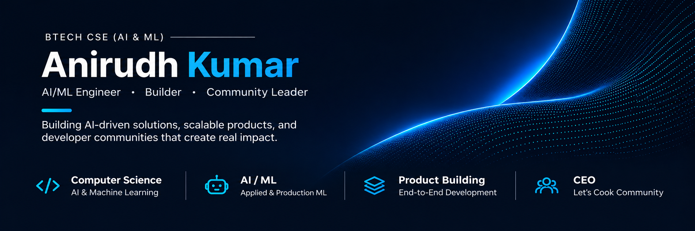

  

 

## Overview

Computer Science undergraduate specializing in **Artificial Intelligence & Machine Learning**. Focused on architecting intelligent systems, robust machine learning workflows, and practical software products that solve real-world operational challenges.

> *"From machine learning experiments to real-world software."*

---

## Featured Projects

### [NeuroScreen AI](https://github.com/anirudhx07?tab=repositories)
**Early Neurological Screening Assessment Platform**

* **Problem:** Traditional neurological screenings are frequently deferred until advanced stages due to limited clinic access, high diagnostic friction, and lack of non-invasive preliminary monitoring tools.
* **Approach:** Developed a guided mobile and algorithmic screening workflow evaluating indicators associated with Parkinson's, Alzheimer's, and epilepsy through non-invasive assessments—including acoustic vocal analysis, motor-response tracking, cognitive memory trials, and reaction latency metrics.
* **Technology:** `Flutter` · `Python` · `Scikit-Learn` · `Signal Processing` · `Machine Learning`
* **Status:** Research Prototype / Iterating
* **Documentation & Code:** [Repository & Notebooks ↗](https://github.com/anirudhx07?tab=repositories)

> [!NOTE]
> *NeuroScreen AI is an engineering and screening-support software project designed for preliminary risk-signal capture, not a replacement for clinical diagnosis or professional medical evaluation.*

 

### [InReal](https://github.com/anirudhx07?tab=repositories)
**Automated Opportunity Intelligence & Fraud-Risk Signal Detection**

* **Problem:** Students and early-career engineers lose significant time and face exposure to exploitative postings and fraudulent hiring listings distributed across online channels.
* **Approach:** Engineered a pipeline that extracts structured metadata from internship notices, cross-references entity profiles across public APIs, and applies heuristics and trained models to compute multi-factor anomaly signals and confidence scores.
* **Technology:** `Python` · `FastAPI` · `REST APIs` · `Automated Intelligence` · `Data Pipelines`
* **Status:** Active Development
* **Documentation & Code:** [Repository & Details ↗](https://github.com/anirudhx07?tab=repositories)

> [!NOTE]
> *InReal generates automated risk signals and intelligence indicators to assist manual evaluation; it does not constitute legal determinations of fraud.*

 

### [MeghNetra](https://github.com/anirudhx07?tab=repositories)
**Geospatial & Scientific Weather Data Analytics**

* **Problem:** Raw atmospheric and geospatial datasets often exist in massive, multi-dimensional structures that are difficult to interpret quickly without specialized analytical tooling.
* **Approach:** Built automated data parsing routines that ingest large-scale meteorological records, transform high-dimensional raster arrays, and produce clean visual analytics and regional weather pattern heatmaps.
* **Technology:** `Python` · `NumPy` · `Pandas` · `Matplotlib` · `Geospatial Analysis` · `Data Visualization`
* **Status:** Exploring / Analytics Engine
* **Documentation & Code:** [Repository & Notebooks ↗](https://github.com/anirudhx07?tab=repositories)

 

### [Automation Lab](https://github.com/anirudhx07?tab=repositories)
**Autonomous AI Agents & Enterprise Workflow Systems**

* **Problem:** High manual overhead and friction in bridging data flow between developer utilities, databases, and LLM-powered services.
* **Approach:** Designed and deployed deterministic agentic workflows and automated pipelines that orchestrate webhooks, API requests, asynchronous scheduling, and LLM prompt chaining to remove repetitive manual tasks.
* **Technology:** `Python` · `n8n` · `AI Agents` · `Docker` · `API Integrations`
* **Status:** Continuous Integration
* **Documentation & Code:** [Repository & Architecture ↗](https://github.com/anirudhx07?tab=repositories)

---

## Technical Capabilities

<table>
  <tr>
    <td width="25%" valign="top"><b>Languages</b></td>
    <td>Python · C++ · Java · JavaScript · TypeScript · SQL · Bash</td>
  </tr>
  <tr>
    <td width="25%" valign="top"><b>AI & Machine Learning</b></td>
    <td>PyTorch · TensorFlow · Scikit-Learn · NumPy · Pandas · Matplotlib · Jupyter</td>
  </tr>
  <tr>
    <td width="25%" valign="top"><b>Web & Application</b></td>
    <td>FastAPI · Flask · Express · Node.js · React · Flutter</td>
  </tr>
  <tr>
    <td width="25%" valign="top"><b>Data & Backend</b></td>
    <td>PostgreSQL · MongoDB · Supabase · Firebase</td>
  </tr>
  <tr>
    <td width="25%" valign="top"><b>DevOps & Workflow</b></td>
    <td>Git · GitHub · Docker · Linux · Postman · Vercel · n8n</td>
  </tr>
</table>

---

## Open Source & Community Leadership

* **Community Development:** Active contributor and builder in developer communities, including collaborative initiatives under the **LET'S COOK** community.
* **Open Source Initiatives:** Working on launching open-source community repositories focused on team-based development, structured code reviews, issue triaging, and real-world project building.
* **Collaboration Focus:** Applied AI tooling, software engineering practices, and peer technical mentorship.

---

## Contact & Connect

Feel free to connect regarding machine learning engineering, software development opportunities, or open-source collaboration:

- **LinkedIn:** [linkedin.com/in/anirudhx07](https://www.linkedin.com/in/anirudhx07/)
- **GitHub:** [github.com/anirudhx07](https://github.com/anirudhx07)
- **Portfolio:** [anirudh-kumar-07.web.app](https://anirudh-kumar-07.web.app)
- **Email:** [anirudhkumar111211@gmail.com](mailto:anirudhkumar111211@gmail.com)

 

  Designed &amp; Maintained by Anirudh Kumar · Engineered for clarity, reliability, and impact.

