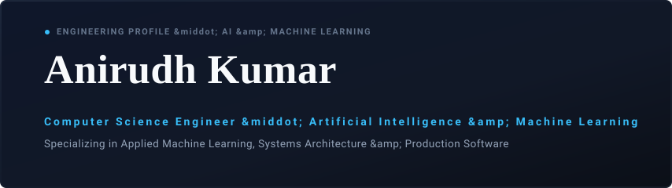
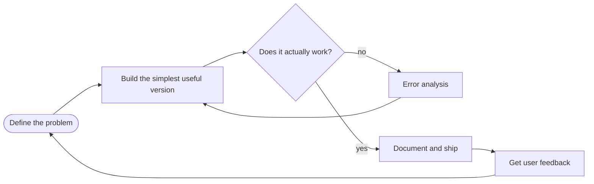

<!--
  MODEL-CARD STYLE GITHUB PROFILE README — ANIRUDH KUMAR
  Save as README.md inside a repo named exactly: anirudhx07/anirudhx07
  Edit project links, and delete any tech icon you haven't actually used.
-->

<div align="center">



<a href="https://github.com/anirudhx07">
  
</a>

<br/>

<a href="https://github.com/anirudhx07"></a>
<a href="https://github.com/anirudhx07?tab=followers"></a>
<a href="https://anirudh-kumar-07.web.app"></a>


</div>

<br/>

```console
$ ./boot_anirudh.sh
[ OK ] loading base weights ........ B.Tech CSE (AI & ML)
[ OK ] mounting curiosity .......... always on
[ OK ] attaching toolchain ......... Python · APIs · automation · a lot of coffee
[ OK ] checking priorities ......... ship > polish > perfect
[WARN] sleep_scheduler ............. deprecated, no replacement planned
[ OK ] ready. waiting for a problem worth solving_
```

---

## 🪪 Model Card

| Field | Value |
|:--|:--|
| **Model name** | Anirudh Kumar |
| **Version** | 2026.10 (a new release every semester) |
| **Architecture** | Computer Science undergrad, specializing in AI and Machine Learning |
| **Training data** | Coursework, side projects, hackathons, documentation, and plenty of failed builds |
| **Fine-tuned on** | ML applications, AI agents, workflow automation, data science, software engineering |
| **Intended use** | Turning murky data and vague ideas into clear, working tools |
| **Out-of-scope use** | Flashy demos that fall over the moment a real user touches them |
| **Known limitations** | Cannot leave a half-working feature alone. Overfits to "just one more fix" at 2 AM. |
| **Evaluation** | Does it run? Does it help someone? Can I explain why it works? |

> [!NOTE]
> This card is a living document. Weights get updated as the work evolves.

---

## 🔁 My Training Loop



---

## 📦 Dependencies

```text
# requirements.txt  (what I actually reach for)

# languages
python  cpp  java  javascript  typescript  sql  bash  html  css

# ai / ml / data
numpy  pandas  scikit-learn  pytorch  tensorflow  jupyter  matplotlib

# web / apis / data stores
react  nodejs  express  fastapi  flask  firebase  supabase  postgres  mongodb

# workflow
git  github  docker  linux  vscode  postman  vercel  n8n  colab  arduino
```

<div align="center">


<br/>

<br/>

<br/>


</div>

---

## 🧪 Experiment Log

<table>
  <tr>
    <td width="50%" valign="top">
      <h3>EXP-001 · 🧠 NeuroScreen AI</h3>
      <p><b>Hypothesis:</b> guided, non-invasive tasks plus supervised ML can support early neurological screening.</p>
      <p><b>Status:</b> </p>
      <p>  </p>
      <p><a href="https://github.com/anirudhx07?tab=repositories">open the notebook ↗</a></p>
    </td>
    <td width="50%" valign="top">
      <h3>EXP-002 · 🛡️ InReal</h3>
      <p><b>Hypothesis:</b> students find opportunities faster if suspicious internship listings are flagged first.</p>
      <p><b>Status:</b> </p>
      <p>  </p>
      <p><a href="https://github.com/anirudhx07?tab=repositories">open the notebook ↗</a></p>
    </td>
  </tr>
  <tr>
    <td width="50%" valign="top">
      <h3>EXP-003 · 🌦️ MeghNetra</h3>
      <p><b>Hypothesis:</b> large scientific datasets become useful once they turn into clear visual outputs.</p>
      <p><b>Status:</b> </p>
      <p>  </p>
      <p><a href="https://github.com/anirudhx07?tab=repositories">open the notebook ↗</a></p>
    </td>
    <td width="50%" valign="top">
      <h3>EXP-004 · ⚙️ Automation Lab</h3>
      <p><b>Hypothesis:</b> structured, AI-assisted workflows can remove repetitive work between services.</p>
      <p><b>Status:</b> </p>
      <p>  </p>
      <p><a href="https://github.com/anirudhx07?tab=repositories">open the notebook ↗</a></p>
    </td>
  </tr>
</table>

> [!IMPORTANT]
> NeuroScreen AI is a software project, not a substitute for professional medical evaluation. InReal's risk indicators are signals, not proof of fraud.

---

## 📊 Metrics

<div align="center">

<a href="https://github.com/anirudhx07">
  
</a>
<a href="https://github.com/anirudhx07">
  
</a>

<br/>


<br/>


<br/><br/>

<a href="https://open.spotify.com">
  
</a>

</div>

---

## 📬 Contact & Connect

<div align="center">

<a href="https://www.linkedin.com/in/anirudhx07/"></a>
<a href="https://github.com/anirudhx07"></a>
<a href="mailto:anirudhkumar111211@gmail.com"></a>
<a href="https://anirudh-kumar-07.web.app"></a>

<br/><br/>

```text
exit code 0 · thanks for stopping by · keep building
```


</div>
